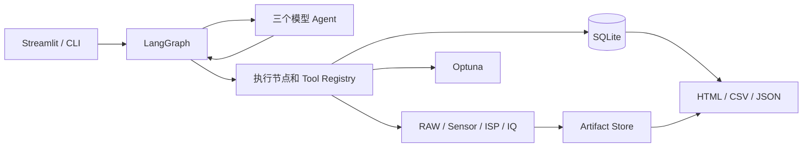
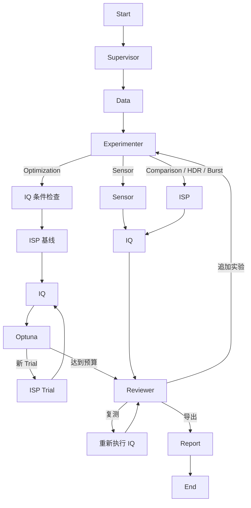

# Camera Intelligence Lab

**Multi-Agent Collaborative Platform for Camera Sensor Analysis, ISP Optimization and Image Quality Evaluation**

Camera Sensor 分析、ISP 算法比较、图像质量测量及参数搜索工作台。没有硬件或 LLM API Key 时，可使用带种子和缺陷标签的模拟数据运行整个流程。

## 安装与运行

需要 Python 3.10+。在项目根目录执行以下命令。

```powershell
python -m venv .venv
.venv\Scripts\Activate.ps1
python -m pip install -r requirements.txt
streamlit run app.py
```

如果默认端口被占用，运行 `streamlit run app.py --server.port 8512`。如果当前终端限制激活脚本，可直接使用 `.venv\Scripts\python -m streamlit run app.py`。

```powershell
python scripts/run_demo.py
pytest -q
python scripts/run_agent_benchmark.py
```

Demo 会保存一个可在 Dataset Manager 中选用的模拟数据集，并实际执行 Sensor、ISP 比较、ISP 优化、HDR 和 Burst。报告路径打印在终端。基准结果写入 `artifacts/benchmark/results.json`，其 SQLite 记录和图像位于同目录。

默认 `CAMERA_LLM_MODE=auto`，无 Key 时使用确定性 Mock 决策。启用在线协作时，复制 `.env.example` 为 `.env` 并填写 `OPENAI_API_KEY`。可用三个角色变量分别绑定模型或具体版本，`CAMERA_LLM_MODEL` 可作为未配置角色的共享回退。可选的 `OPENAI_BASE_URL` 接受支持 Chat Completions 强制函数调用的兼容端点。

| 环境变量 | 默认模型 |
| --- | --- |
| `CAMERA_SUPERVISOR_MODEL` | `gpt-6.1-terra` |
| `CAMERA_EXPERIMENTER_MODEL` | `gpt-6-luna` |
| `CAMERA_REVIEWER_MODEL` | `gpt-6.1-sol` |

使用 DeepSeek 官方 API 时，将 `OPENAI_BASE_URL` 设为 `https://api.deepseek.com`，在 `OPENAI_API_KEY` 填写 DeepSeek Key。三个角色可分别设为 `deepseek-flash`、`deepseek-flash`、`deepseek-v4-pro`。保留 `CAMERA_LLM_MODE=openai`，该值表示使用 OpenAI 兼容协议。程序会为 DeepSeek 关闭思考模式以支持指定函数调用。

模型接收任务文本、允许的选项与必要的测量摘要。Pydantic 和执行层共同验证模型返回的决策。RAW 像素和完整图像由本地工具读取。Mock 在同一工作流中执行默认方案，并在首次审查后导出。Agent Workspace 区分模型调用、Mock 决策和执行节点。

可选 DNG 依赖可用 `python -m pip install -e ".[dng]"` 安装。PyTorch 与 colour-science 提供独立的 `research` 安装组，当前算法路径使用 NumPy、SciPy、OpenCV 与 scikit-image。

## 工作台

| 页面 | 操作 |
| --- | --- |
| Dashboard | 查询任务、实验、节点成功率和最近报告 |
| Dataset Manager | 生成模拟数据，上传 RAW/DNG、暗场、平场、PTC 档位、HDR、Burst、参考与斜边 ROI，查看 Bayer 排布与原始 DN 直方图 |
| Sensor Analysis | 运行暗平场分析，检查坏点、行列噪声、DSNU、PRNU 和 PTC |
| ISP Lab | 比较三个去马赛克算法，调节镜头阴影、降噪、WB、CCM、Gamma，保存中间图，运行独立 ISP 阶段或 HDR/Burst |
| IQ Evaluation | 按实验查看测量值、条件、有效状态、输入 Artifact 和读数对比 |
| Agent Workspace | 提交自然语言任务，检查三个 Agent 的模型、决策、Token，查看执行节点、工具返回和复测结果 |
| Optimization Lab | 设置搜索上限，查看搜索空间、Trial 数据、Pareto 前沿和推荐配置 |
| Experiment Reports | 浏览历史图像、指标和轨迹，下载 HTML、CSV、JSON |

在 Dataset Manager 生成数据后，可在 Agent Workspace 输入以下任务。

- 分析暗场、平场、热像素、死像素和 PTC。
- 比较 bilinear、edge_adaptive 与 VNG 的去马赛克结果。
- 优化低照度 ISP，平衡噪声、细节与颜色误差。可先在生成数据时将相对照度设为 0.17。
- 进行 HDR 曝光融合。或执行 Burst 多帧降噪。

## 系统架构与实现特点

LangGraph 调度三个模型 Agent 和确定性的执行节点。模型按角色产生路由、实验方案或审查决策。Data、Sensor、ISP、IQ、Optuna 和报告导出位于 `src/execution/`，通过已注册工具处理图像、计算指标和保存产物。每个 Optuna Trial 经过相同 ISP 与 IQ 节点。



| Agent | 职责 |
| --- | --- |
| Supervisor | 识别任务类型与优化偏好，交给实验策划 |
| Experimenter | 在可用数据与配置范围内选择去马赛克方案、平场或 PTC 测量，根据审查反馈追加未测选项 |
| Reviewer | 检查实测摘要，选择导出报告、追加实验或对已有结果复测 IQ。每次运行最多发起一次追加或复测 |



路由和失败归档见 `src/orchestration/graph.py`。模型 Agent 可重试决策失败，Data 可重试非验证异常。对有副作用的阶段，失败时保留记录并停止，活跃 Trial 标记失败。SQLite 实验状态和 JSON 报告记录角色、模型、结构化决策与 Token。JSON 报告包含导出时已完成节点的轨迹，数据库保留完整执行轨迹。

## RAW 与 Camera 工具

`configs/sensor.yaml` 提供 width、height、bit_depth、storage_format、bayer_pattern、black_level、white_level、endianness。支持 8 位字节、8/10/12/14/16 位 LSB 对齐的 16 位容器，以及紧密排列的 MIPI RAW10/12/14。支持 RGGB、BGGR、GRBG、GBRG。MIPI 采用高字节随后小端低位域的像素组排列，要求每行完整分组。文件长度必须与声明一致。行填充、嵌入式元数据、未知打包格式和厂商私有对齐需要先转换。Bayer 使用配置或 DNG 元数据；单张未知 RAW 的 Bayer 推断超出当前验证范围。

工具按 Data、Sensor、ISP、IQ、Optimization、Report 分组。文件类工具接收已注册的 Artifact ID。独立 ISP 阶段接收相应形状的数值数组 Artifact。调用结果包含记录状态与耗时，算法不直接暴露给 LLM 执行任意代码。

## 算法与测量

- Sensor 计算多帧均值、时间方差、DSNU、CFA 相位归一化 PRNU、异常点与行列均值，并在 PTC 条件满足时估计 DN/e⁻ 和饱和。
- ISP 按黑电平、坏点、镜头阴影、去马赛克、WB、CCM、降噪、锐化、Gamma 处理。双线性在已知 CFA 样本上做归一化卷积。边缘自适应按梯度估计绿色通道，再插值色差。OpenCV VNG 使用 8 位输入。HDR 使用曝光加权融合，Burst 使用对齐帧均值。
- IQ 返回 PSNR、SSIM、ΔE00、MTF50、SNR、Noise、DR 的数值、单位、方法、输入和局限。无参考条件下可测量适配的 ROI 噪声。MTF50 使用专用斜边输入，DR 依赖暗场与 PTC。
- Optuna 最小化均匀 ROI 噪声和 ΔE00 并最大化 SSIM，搜索 Gamma、降噪、锐化和 RGB 增益。报告给出与基线的逐指标变化。推荐配置按 Pareto 候选的归一化加权值选取，允许出现目标间取舍。时间预算在尝试新 Trial 前检查，正在运行的单次 ISP/IQ 会结束后再停止。

公式、实验基线与消融矩阵见 [实验协议](docs/experiment_protocol.md)。测试覆盖 RAW 向量、四种 CFA、算法操作、指标条件、参数验证、工作流、错误记录、报告与数据库一致性及八个页面渲染。

## 已知局限

模拟数据检验软件逻辑和测量条件，传感器校准与 ISP 质量仍需实采验证。DNG 支持 Bayer、公共黑电平和可识别位深。HDR/Burst 输入须对齐，当前未实现运动配准或去鬼影。阴影校正使用径向增益近似。斜边测量为直边实验估计。LLM 在线模式需要可用凭据，Mock 基准只检验路由与算法执行。单 Agent + Tools 使用同一工具与计算策略，对比着重执行拓扑；架构性能结论还需要在线模型对照和重复运行。
